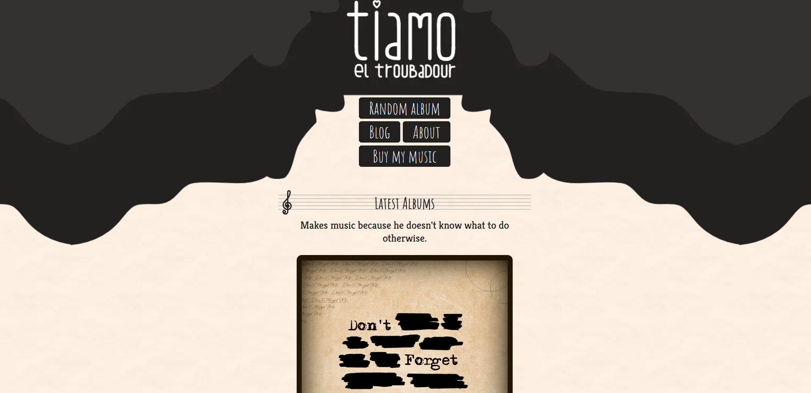
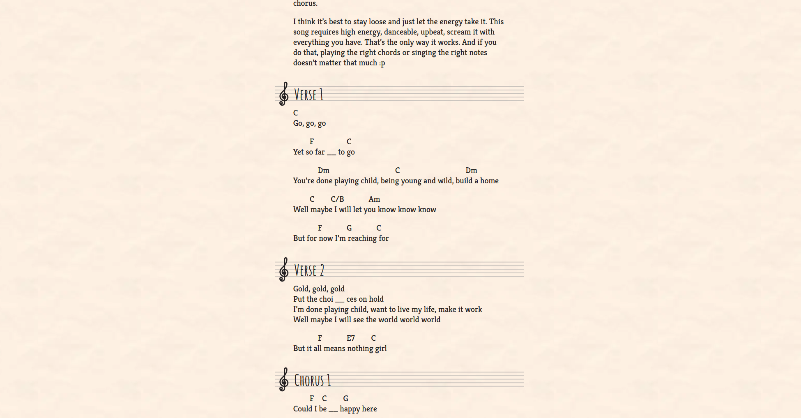

# El Troubadour

This is the full source code / project behind [El Troubadour](https://eltroubadour.com). It's the official website of Tiamo, El Troubadour (musician).

## What Is It?

The website contains

* **ALBUMS/SINGLES:** Information about them and links to popular streaming platforms.
* **LYRICS:** Official lyrics for all songs.
* **TABS:** Official tabs/chords for all songs.
* **DIARIES:** Articles about the process of writing the songs, recording the music, and more.

## Project Structure

It's made using Hugo. That means it's a static website that rebuilds automatically whenever this repository is updated.

The actual website is inside `el-troubadour`. Everything else is metadata or supportive documents for the project.

Nothing is hidden or changed for this public version. It's the actual website, as I build it and host it. You might even find as of yet unpublished stuff there.

It's also the very first one I made using this new Hugo system I just discovered, so it's quite inefficient and not an example of good practices. (One day ... one day ... I'll update all my websites to the same efficient Hugo code.)

I'm open sourcing all my websites in an effort towards an open world based on sharing and transparency. It's the least I can do.